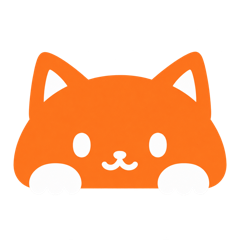
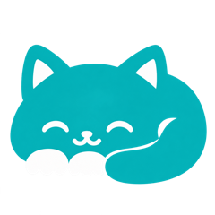
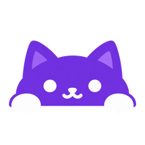
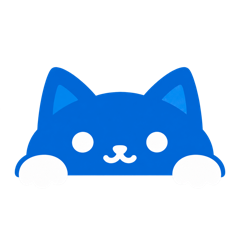
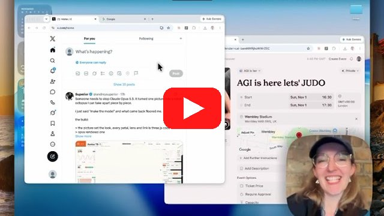

# Pika Dots

<p align="center">
  
  
  
  
</p>

A native macOS menu-bar app with a shelf of tiny cat companions. Drag a cat onto any window (Chrome, Notes, or another standard app), tell it what you're doing, and it helps with that window: keeping you on task, nudging you to take a break, explaining what's on screen, or carrying out tasks in Chrome.

Current version: **0.11.0**. See the [release notes](docs/RELEASE_0.11.0.md).

## Demo

[](https://youtu.be/Agd_avP2Ve8)

▶️ [Watch the demo on YouTube](https://youtu.be/Agd_avP2Ve8) (1:32)

We're big fans of context bots, but we thought we could do one better. Pika Dots are **context-specific, task-bound agents**: you attach each cat to a specific window, then ask it to carry out tasks for you or supervise your work.

In the demo, AGI is finally here and someone has to control it, so we're organising a judo showdown at Wembley Stadium between Sam, Dario and Elon.

1. **Focus cat on the window.** The Focus companion uses OpenAI's Decisions API to classify what's on screen, such as the current Chrome tab, as *on task* or *distracting*.
2. **Actions cat sends the invites.** We ask the Actions cat to draft and send invites to Elon, Dario and Sam in Chrome. It works through the task step by step while we carry on setting up the event description.
3. **Getting distracted.** We drift off to YouTube for some cat videos. *Meow, meow.* The Focus cat notices and tells us to get back to work.

Each pet stays bound to its own window and task, and you can pick up wherever it left off.

## Download

[Download the compiled Mac app (v0.11.0)](https://github.com/lukataylo/pika-dots/releases/tag/v0.11.0). Unzip it, move **Pika Dots.app** to Applications, and open it.

- Universal (Apple Silicon and Intel), macOS 14+
- Developer ID signed, not notarized
- No API keys or personal data are bundled; each person adds their own key in Settings

## Companions

| | Cat | Mode | What it does |
|:-:|---|---|---|
|  | **Focus** (orange) | Supervisor | Runs a focus session (15, 25, 50 min or open-ended) on the attached window. Checks whether you're on task and nudges you back when you drift; shows a summary at the end. |
|  | **Chill** (teal) | Supervisor | Starts a short break (1, 2, 5 or 10 min) and tells you when it's over. |
|  | **Explain** (purple) | Promptable | Ask a question about the attached window; it looks at that window and replies briefly. |
|  | **Actions** (blue) | Promptable | Carries out a task in your Google Chrome tab, one step at a time: search, navigate, compare, fill forms, take notes. Asks before anything consequential. |

Use **+** on the shelf to create your own companion: write its skill in Markdown, choose Promptable or Supervisor, and save. Skills and settings are stored in `~/Library/Application Support/PikaDots/`.

## Use

1. Click the menu-bar icon to open the shelf of cats. Right-click the shelf for **Stop all** or **Quit**.
2. Drag a cat onto a window (or click its name to attach it to the topmost window). The cat sits on the window's edge and follows it as you move, resize, or reorder windows.
3. Click the cat to open a small purpose pill. Type (or speak) its purpose or question and press the arrow. Purposes are remembered per companion and app.
4. Right-click the cat for status, **Check now**, pause/start supervision, settings, and dismissing it.
5. Answers to your questions appear in a small reply card next to the cat. Periodic nudges arrive as short native notifications (at most 14 words); if notifications are off, a small corner banner is shown instead.

Up to one cat per window; different cats can watch different windows at once.

### Focus details

- Window content is checked against your purpose about every 15 seconds while the window is in front; background and minimized windows are skipped.
- YouTube window titles are checked every two seconds. Optional settings can show a dismissible pause screen and, after repeated warnings, close the YouTube tab (Safari, Chrome, Brave, Edge, and Arc).
- Focus can use OpenAI's **Decisions** API for fast yes/no on-task checks, or the **Responses** API. Switch to Responses in the companion's settings if you don't have Decisions access.

### Actions details

- Works only in **Google Chrome**. Turn on **View → Developer → Allow JavaScript from Apple Events** in Chrome first.
- Asks for approval before outward actions such as sending, posting, submitting, purchasing, or deleting. It stops for logins, CAPTCHAs, and payment details so you can take over.
- Outward actions are capped at 10 per day.
- Under **Allowed websites** in its skill, list domains where it may act without asking.
- **YOLO** mode (the bolt button) runs without asking. Payments still ask.
- Keeps short task notes from recent runs (last 24 hours) locally, so follow-up tasks can build on them.

### Voice and sounds

Click the microphone to talk to a cat instead of typing. Audio is transcribed and not stored. Cats can play short synthesized sounds (mrrp, meow, yowl); change or remove them in the `## Sounds` section of a skill.

## Permissions

macOS will ask for these the first time they're needed:

| Permission | Needed for |
|---|---|
| Screen & System Audio Recording | Seeing the attached window (all companions) |
| Automation (Apple Events) | Actions in Chrome; closing YouTube tabs in Focus |
| Microphone and Speech Recognition | Voice input (optional) |
| Notifications | Short replies and nudges (optional; banner fallback) |

The gear button on the shelf shows permission status and can request access, open System Settings, and restart the app. Approving a permission is always your own action in macOS.

## Configure

Add your OpenAI API key in **Settings** (gear button); it's stored in your Mac's Keychain. For development you can instead put `OPENAI_API_KEY` in an ignored `.env.local` file at the repository root or in `~/Library/Application Support/PikaDots/.env.local`, or set it as an environment variable. Keys are read at request time and never included in the app bundle.

Optional settings in the same places:

- `OPENAI_MODEL`: model for replies and Actions (default `gpt-4.1-mini`)
- `OPENAI_DECISIONS_MODEL`: model for Decisions checks (default `gpt-6-luna`)

## Privacy

- A screenshot of the attached window is sent to OpenAI only for a question, a supervision check, or an Actions step.
- Typing activity uses a local idle-time signal only; typed text, key codes, and clipboard contents are never recorded.
- Purposes, custom skills, and Actions notes stay on your Mac.

## Build from source

Requires macOS 14+ and the Swift 6 command-line tools.

```sh
./scripts/build-app.sh
open "dist/Pika Dots.app"
```

Or open `Package.swift` in Xcode. The app lives in the menu bar, not the Dock; quit any running copy before launching a new build.

Run the tests (optional live API tests are skipped without a key):

```sh
swift test
```

To make a release package, run `scripts/package-release.sh`. Set `PIKA_SIGN_IDENTITY` to a Developer ID certificate to sign it.

## Scope and limitations

- All apps use the same window-ID-based capture; there's no browser extension, and no Accessibility permission is needed. Protected content may not be capturable.
- Cats follow windows using a short polling loop, not a native cross-process child-window link. A minimized window, or one on another Space, hides its cat until it comes back. Closing a window leaves its cat inactive until you reattach it.
- For full-screen windows, the purpose pill sits just inside the top edge.
- Live API calls, Chrome automation, microphone permissions, and Intel runtime behavior haven't been verified end to end in 0.11.0. Check them on each teammate's Mac.

## More docs

- [Team testing instructions](docs/TEAM_TESTING.md)
- [Participant tracks](docs/PARTICIPANT_TRACKS.md): extend the existing components rather than adding parallel implementations
- [Supervision test results](docs/SUPERVISION_TEST_RESULTS.md)
- [Character artwork and prompts](docs/CHARACTER_ARTWORK.md), plus design sheets in `docs/design/`
- Release notes: `docs/RELEASE_*.md`
