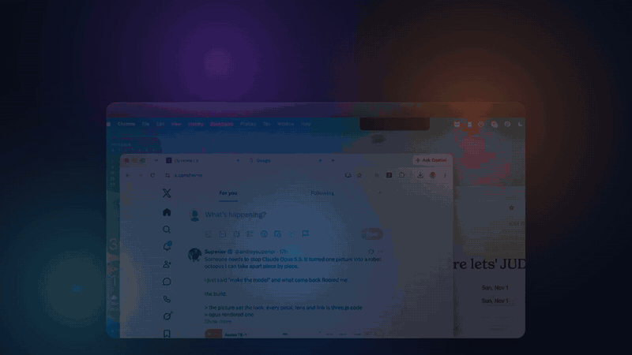
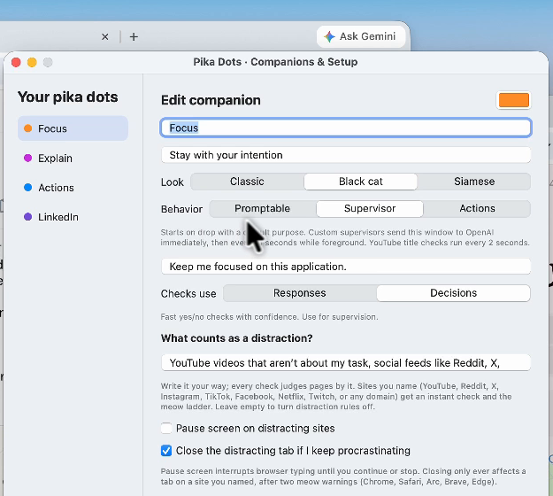

<p align="center">
  
</p>

<h1 align="center">Pika Dots</h1>

<p align="center">
  <b>Tiny AI cats for every window on your Mac.</b><br>
  Drag one onto any window, tell it what you're doing, and it keeps an eye on that window for you.
</p>

<p align="center">
  <a href="https://github.com/lukataylo/pika-dots/releases/download/v0.11.0/PikaDots-0.11.0-universal.zip"></a>
</p>

<p align="center">
  macOS 14 or later · Apple Silicon and Intel · 3 MB · Free and open source · Bring your own OpenAI key
</p>

---

## What it does

Pika Dots lives in your menu bar as a shelf of small cats. Each cat is an AI companion with one job. Drop it on a window and it watches that window, so the help sits where you're already working.

| Cat | Good for | What happens |
|---|---|---|
| 🟠 **Focus** | Staying on task | You say what you're finishing. It checks the window as you work and nudges you back if you drift. Open YouTube mid-task and it says *"Meow. YouTube can wait."* |
| 🟢 **Chill** | Taking real breaks | Starts a 1, 2, 5 or 10 minute break and tells you when it's over. |
| 🟣 **Explain** | Understanding a screen | Ask anything about the window it's sitting on and get a short answer. |
| 🔵 **Actions** | Doing the clicking | Carries out a task in your Chrome tab step by step: search, compare, fill forms, take notes. It asks before anything gets sent. |

You can also make your own cat. Each one runs on a skill written in plain Markdown.

## Get started in 3 minutes

### 1. Download and install

1. Click **[Download for Mac](https://github.com/lukataylo/pika-dots/releases/download/v0.11.0/PikaDots-0.11.0-universal.zip)**.
2. Open the zip and drag **Pika Dots.app** into your **Applications** folder.
3. Open it from Applications. A cat icon appears in your menu bar. There's no Dock icon, which is expected.

> **"Apple could not verify Pika Dots" warning?**
> The app is signed but not yet notarized by Apple, so macOS asks you to confirm the first time.
> Open **System Settings → Privacy & Security**, scroll down and click **Open Anyway** next to Pika Dots. You only need to do this once.

### 2. Add your OpenAI key

1. Click the cat icon in the menu bar, then the **gear** button on the shelf.
2. Paste your OpenAI API key. You can create one at [platform.openai.com/api-keys](https://platform.openai.com/api-keys).

The key is stored in your Mac's Keychain and is only used to talk to OpenAI.

### 3. Allow screen access

The first time a cat looks at a window, macOS asks for **Screen & System Audio Recording** permission. Allow it, then restart Pika Dots if macOS asks you to. The gear button shows each permission's status and can take you straight to the right settings page.

### 4. Drop your first cat

1. Click the menu-bar icon to open the shelf.
2. Drag **Focus** onto the window you're working in.
3. Click the cat, type what you're finishing (for example *"Write the launch post"*) and press the arrow.

That's it. Keep working and Focus will keep you honest.

## Everyday use

- **Attach a cat:** drag it onto a window, or click its name on the shelf to attach it to the window in front. One cat per window, and different cats can watch different windows at once.
- **Give it a job:** click the cat to open its pill, then type or speak (🎤). Purposes are remembered per cat and per app.
- **See what it's doing:** right-click the cat for its status, **Check now**, pause or resume, and settings.
- **Move it:** drag the cat to another window. It follows its window when you move or resize it.
- **Stop everything:** right-click the shelf and choose **Stop all**.

Answers appear in a small card next to the cat. Nudges arrive as short notifications of 14 words or fewer, or as a small corner banner if notifications are off.

## Make your own cat



Click **+** on the shelf to open **Companions & Setup**.

1. Give your cat a name, a look and a one-line summary.
2. Pick a behaviour:
   - **Promptable** answers when you ask it something.
   - **Supervisor** checks the window on its own while you work.
   - **Actions** carries out tasks in Chrome.
3. Write its skill in Markdown: what it should look for and how it should talk to you.
4. Save, then drag it onto a window.

Skills live in `~/Library/Application Support/PikaDots/`, so you can back them up or share them.

<br clear="right">

## Privacy

- A picture of the attached window is sent to OpenAI only when you ask a question, when a Supervisor runs a check, or for an Actions step.
- Typing activity is measured with a local idle timer. Typed text, key codes and clipboard contents are never recorded.
- Your key stays in your Keychain. Purposes, custom skills and Actions notes stay on your Mac.

## Troubleshooting

<details>
<summary><b>The cat says it can't see the window</b></summary>

Open **System Settings → Privacy & Security → Screen & System Audio Recording** and make sure Pika Dots is switched on. Quit and reopen the app afterwards. Some protected content, such as DRM video, can't be captured.
</details>

<details>
<summary><b>Actions isn't doing anything in Chrome</b></summary>

Actions only works in Google Chrome. In Chrome, turn on **View → Developer → Allow JavaScript from Apple Events**. Then allow Pika Dots under **System Settings → Privacy & Security → Automation**.
</details>

<details>
<summary><b>Focus checks fail with an API error</b></summary>

Focus uses OpenAI's Decisions API by default for quick on-task checks. If your account doesn't have access, open the Focus cat's settings and switch **Checks use** to **Responses**.
</details>

<details>
<summary><b>The cat disappeared</b></summary>

Cats hide when their window is minimized or on another Space, and come back with it. If you closed the window, drag the cat onto a new one.
</details>

<details>
<summary><b>I don't get notifications</b></summary>

Allow notifications for Pika Dots in **System Settings → Notifications**. Until then, nudges appear as a small banner in the corner of the screen.
</details>

## Reference

### Focus

- Window content is checked against your purpose about every 15 seconds while the window is in front. Background and minimized windows are skipped.
- Sessions can run for 15, 25 or 50 minutes, or open-ended, with a summary at the end.
- YouTube window titles are checked every two seconds. Optional settings can show a dismissible pause screen and, after repeated warnings, close the YouTube tab (Safari, Chrome, Brave, Edge and Arc).
- Focus can use OpenAI's **Decisions** API for fast yes/no on-task checks, or the **Responses** API.

### Actions

- Works only in **Google Chrome**, with **Allow JavaScript from Apple Events** turned on.
- Asks for approval before outward actions such as sending, posting, submitting, purchasing or deleting. It stops for logins, CAPTCHAs and payment details so you can take over.
- Outward actions are capped at 10 per day.
- Under **Allowed websites** in its skill, list domains where it may act without asking.
- **YOLO** mode (the bolt button) runs without asking. Payments still ask.
- Keeps short task notes from the last 24 hours locally, so follow-up tasks can build on them.

### Voice and sounds

Click the microphone to talk to a cat instead of typing. Audio is transcribed and not stored. Cats can play short synthesized sounds (mrrp, meow, yowl). Change or remove them in the `## Sounds` section of a skill.

### Permissions

macOS asks for these the first time they're needed:

| Permission | Needed for |
|---|---|
| Screen & System Audio Recording | Seeing the attached window (all cats) |
| Automation (Apple Events) | Actions in Chrome, and closing YouTube tabs in Focus |
| Microphone and Speech Recognition | Voice input (optional) |
| Notifications | Short replies and nudges (optional, with a banner fallback) |

### Configuration

The key set in **Settings** is stored in the Keychain. For development you can instead put `OPENAI_API_KEY` in an ignored `.env.local` file at the repository root or in `~/Library/Application Support/PikaDots/.env.local`, or set it as an environment variable. Keys are read at request time and never included in the app bundle.

Optional settings in the same places:

- `OPENAI_MODEL`: model for replies and Actions (default `gpt-4.1-mini`)
- `OPENAI_DECISIONS_MODEL`: model for Decisions checks (default `gpt-6-luna`)

### Scope and limitations

- All apps use the same window-ID-based capture. There's no browser extension, and no Accessibility permission is needed.
- Cats follow windows using a short polling loop, not a native cross-process child-window link.
- For full-screen windows, the purpose pill sits just inside the top edge.
- Live API calls, Chrome automation, microphone permissions and Intel runtime behavior haven't been verified end to end in 0.11.0.

## Build from source

Requires macOS 14+ and the Swift 6 command-line tools.

```sh
./scripts/build-app.sh
open "dist/Pika Dots.app"
```

Or open `Package.swift` in Xcode. Quit any running copy before launching a new build.

Run the tests (optional live API tests are skipped without a key):

```sh
swift test
```

To make a release package, run `scripts/package-release.sh`. Set `PIKA_SIGN_IDENTITY` to a Developer ID certificate to sign it.

### More docs

- [Release notes for 0.11.0](docs/RELEASE_0.11.0.md), with earlier versions in `docs/RELEASE_*.md`
- [Team testing instructions](docs/TEAM_TESTING.md)
- [Participant tracks](docs/PARTICIPANT_TRACKS.md): extend the existing components rather than adding parallel implementations
- [Supervision test results](docs/SUPERVISION_TEST_RESULTS.md)
- [Character artwork and prompts](docs/CHARACTER_ARTWORK.md), plus design sheets in `docs/design/`

---

<p align="center">
  Built at the OpenAI DevDay Community Hackathon in London, November 2026.
</p>
